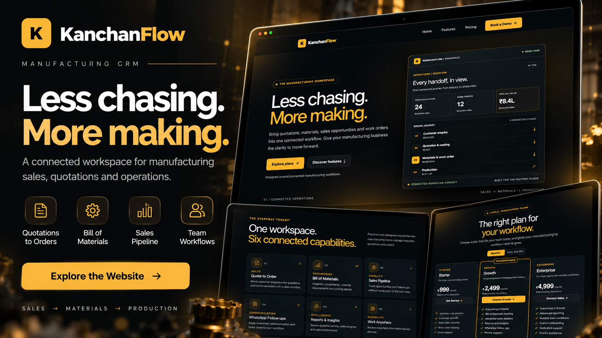

# KanchanFlow — Industrial Workflow Landing Page

<p align="center">
  
</p>

A modern, responsive marketing website for **KanchanFlow**, a manufacturing workflow concept featuring an industrial-modern design, dark graphite backgrounds, gold accents, clean layouts, and smooth animations.

## ✨ Features

- **Home Page** — Hero section, dashboard preview, product highlights, industry overview, pricing teaser, FAQs, and call-to-action sections.
- **Features Page** — Overview of the product's key capabilities.
- **Pricing Page** — Starter, Growth, and Enterprise pricing plans.
- **Monthly/Yearly Toggle** — Switch between billing options.
- **FAQ Accordion** — Expandable answers to common questions.
- **Responsive Navbar** — Navigation links and a mobile-friendly menu.
- **Framer Motion Animations** — Smooth entrance, scroll-reveal, and hover animations.
- **Animated Particle Background** — Small glowing dots that move and blink across the page.
- **Responsive Design** — Layouts designed for mobile, tablet, laptop, and desktop screens.
- **Reusable Components** — Consistent UI components and styling.
- **SEO Metadata** — Page metadata configured for search engines.

## 🛠️ Tech Stack

- Next.js
- React
- JavaScript
- CSS
- Tailwind CSS
- Framer Motion
- Node.js
- npm

## 🎨 Design

The website follows an industrial-modern visual style using:

- Dark graphite backgrounds
- Gold accent colors
- Steel-gray supporting tones
- Clean typography
- Dashboard-inspired visuals
- Subtle animations and glowing particle effects
- Responsive layouts

## 📁 Project Structure

```text
kanchanflow/
├── app/
│   ├── globals.css
│   ├── layout.js
│   ├── page.js
│   ├── features/
│   │   └── page.js
│   └── pricing/
│       ├── page.js
│       └── PricingContent.js
├── components/
│   ├── Navbar.jsx
│   ├── Footer.jsx
│   ├── ParticleBackground.jsx
│   └── HomeAnimations.jsx
├── public/
│   └── images/
│       └── kanchanflow-preview.png
├── package.json
├── package-lock.json
├── next.config.mjs
└── README.md
```

## 🚀 Getting Started

### Prerequisites

Make sure you have the following installed:

- Node.js
- npm

### 1. Clone the repository

```bash
git clone https://github.com/bs-bhaskar/kanchanflow.git
```

### 2. Navigate to the project directory

```bash
cd kanchanflow
```

### 3. Install dependencies

```bash
npm install
```

### 4. Start the development server

```bash
npm run dev
```

Open [http://localhost:3000](http://localhost:3000) in your browser.

## 📄 Pages

| Route | Description |
|---|---|
| `/` | Home page with hero, workflow preview, features, pricing teaser, and FAQs |
| `/features` | Product features and capabilities |
| `/pricing` | Pricing plans, billing options, comparison, and FAQs |

## 📱 Responsive Design

The website is designed to adapt to different screen sizes:

- **375px** — Mobile
- **768px** — Tablet
- **1024px** — Laptop
- **1440px** — Desktop

## 🎞️ Animations

Framer Motion is used to enhance the website experience with:

- Smooth entrance animations
- Scroll-triggered section reveals
- Feature card hover effects
- Animated glowing particles
- Reduced-motion support where implemented

The animations are designed to complement the website's industrial-modern visual style without distracting from the content.

## 🧪 Production Build

Create an optimized production build:

```bash
npm run build
```

Start the production server locally:

```bash
npm run start
```

Run the production build after making changes to verify that the application builds successfully.

## 💰 Pricing Disclaimer

The pricing plans and amounts displayed on the website are illustrative and should not be considered official KanchanFlow pricing.

## 🔗 Project Links

- **Live Demo:** [Website URL](https://kanchanflow-five.vercel.app/)
- **GitHub Repository:** [GitHub URL](https://github.com/bs-bhaskar/kanchanflow.git)

## 👨‍💻 Author

**Bhaskar Yogi**

Developed as a frontend website project using Next.js, React, JavaScript, CSS, and Framer Motion.
